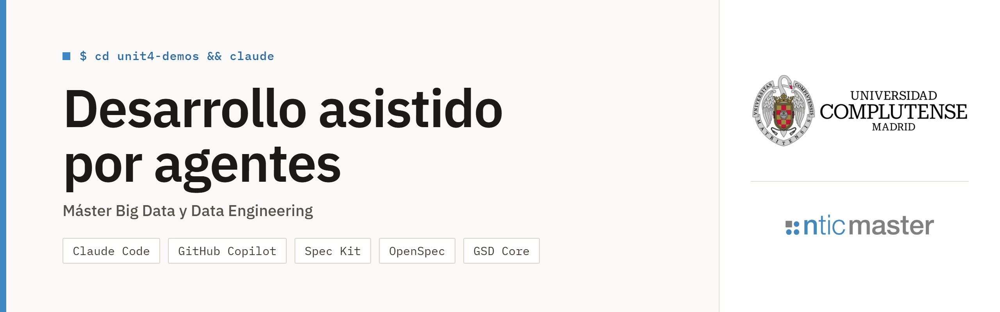

# Kivora · pipeline de ventas

> **Práctica final del módulo Desarrollo asistido por agentes.** El enunciado
> está en [`assignment.md`](assignment.md).

**Kivora** es una tienda online de moda y complementos con clientes en España,
el resto de Europa, Reino Unido y Estados Unidos. El **equipo de datos**
mantiene este pipeline en Python y SQLite, que convierte las entregas diarias
de la tienda en tablas de negocio. Se desarrolla con **Claude Code**.

## Qué hace

Lee `data/inbox/` (una carpeta por día), lo carga en SQLite
(`output/warehouse.db`), aplica transformaciones SQL y Python y escribe las
tablas de negocio en `output/`.

**Datos de entrada** (cada carpeta de día trae los registros nuevos o
modificados de ese día; formato en [`docs/sources.md`](docs/sources.md)):

| Fichero | Contenido |
| --- | --- |
| `orders.csv` | Pedidos, con moneda EUR, USD o GBP |
| `customers.csv` | Clientes (el país puede venir vacío) |
| `payments.csv` | Intentos de pago (`captured` o `failed`) |
| `refunds.json` | Devoluciones, desde el 2026-09-04. **Dos formatos conviven**: `amount` hasta el 2026-09-07 y `refund_amount` más `reason` desde el 2026-09-08 |
| `data/reference/fx_rates.csv` | Tipos de cambio a euros |

**Tablas de salida** (en `output/`, que se regenera y no se versiona):

| Fichero | Qué contiene | Contrato |
| --- | --- | --- |
| `daily_customer_metrics.csv` | Por cliente y día: pedidos, bruto, devuelto, neto, devoluciones y última compra, todo en EUR y con la fecha de Madrid (Finanzas) | [`docs/specs/KIV-101/spec.md`](docs/specs/KIV-101/spec.md), sección 5 |
| `rejected.csv` | Cada pedido o devolución que no se pudo procesar, con su motivo | ídem |
| `quality_report.json` | Seis controles de calidad (`passed` y `failed_records`) | ídem |
| `daily_sales.csv` | Ventas por día y país (Dirección Comercial) | [`docs/data-contracts/daily_sales.md`](docs/data-contracts/daily_sales.md) |
| `top_customers.csv` | Los diez clientes que más han comprado | — |

> **Limitación conocida.** `daily_sales.csv` y `top_customers.csv` son las
> salidas heredadas y **no cumplen del todo su contrato** (no convierten de
> moneda, usan la fecha UTC y pueden contar de más un pedido con varios
> pagos). Se decidió no modificarlas: ver
> [`docs/review.md`](docs/review.md), hallazgo H1. Las cifras fiables están en
> `daily_customer_metrics.csv`.

Reglas principales: los importes se convierten a EUR con `fx_rates.csv`; cada
pedido cuenta una vez con su última versión; una devolución resta del día de la
compra; lo que no cuadra va a `rejected.csv`, no se descarta en silencio; el
pipeline termina con código 0 aunque haya rechazos o controles en rojo.

## Preparar el entorno

Se necesitan [uv](https://docs.astral.sh/uv/), Git y Claude Code. Python 3.11
o superior (`uv` lo descarga si no está). Funciona igual en Windows, macOS y
Linux.

```bash
uv sync
uv run python tasks.py setup
```

Si activas el entorno virtual (`.venv\Scripts\Activate.ps1` en PowerShell,
`source .venv/bin/activate` en macOS y Linux), puedes omitir `uv run`.

## Ejecutar

```bash
uv run python -m kivora --inbox data/inbox --reference data/reference --out output
```

Es la interfaz de ejecución que usa Plataforma y **no se puede cambiar**; las
tres opciones tienen esos valores por defecto. `uv run python tasks.py run` es
equivalente.

| Orden | Qué hace |
| --- | --- |
| `python tasks.py setup` | Comprueba la versión de Python y las dependencias |
| `python tasks.py run` | Ejecuta el pipeline sobre `data/inbox/` y escribe `output/` |
| `python tasks.py test` | Ejecuta los tests (pytest) |
| `python tasks.py acceptance` | Oráculo de aceptación (ver más abajo) |
| `python tasks.py check` | Comprueba los ficheros, columnas y formatos de `output/` |
| `python tasks.py reset` | Borra `output/` |
| `python tasks.py deliver N` | Simula la entrega `N` de la tienda (1 o 2) y su ticket. Cada una se recibe una sola vez y en orden; **ya están recibidas** |

## Cómo se prueba

| Comprobación | Orden | Qué garantiza |
| --- | --- | --- |
| Tests | `uv run python tasks.py test` | 51 tests: pipeline (4), KIV-101 (16) y KIV-102 (31). Usan datos sintéticos y los datos reales, y los casos exigidos por el enunciado fallan con el código roto |
| Aceptación | `uv run python tasks.py acceptance` | Ejecuta el pipeline sobre una copia de `data/inbox/` con las cifras reales: 28 comprobaciones de KIV-101 (días hasta el 2026-09-07) y 21 de KIV-102 (los 10 días). Código 0 solo si pasan todas |
| Salidas | `uv run python tasks.py check` | Ficheros y formatos de `output/` tras `run` |
| Guard | `uv run python -m pytest .claude/hooks -q` | Los 34 tests del hook de protección |

Un trabajo está terminado cuando pasan `test`, `acceptance` y `check`, el
resultado cumple los contratos y las decisiones están documentadas en `docs/`.
Dos ejecuciones sobre los mismos datos dan ficheros idénticos.

**Resultado de referencia** con los 10 días de `data/inbox/`: 213 ventas,
25.072,41 € brutos, 1.642,04 € devueltos en 43 devoluciones, 23.430,37 €
netos, 164 filas cliente-día y 4 registros rechazados.

## Cómo se trabaja con Claude Code

- **Contexto del agente:** [`CLAUDE.md`](CLAUDE.md) (qué es el proyecto, cómo
  se ejecuta y se prueba, qué no se toca y cuándo un trabajo está terminado).
- **Flujo de cada cambio:** analizar el impacto, escribir la especificación y
  el plan, escribir los tests y el oráculo y comprobar que fallan, implementar
  lo mínimo y verificar con `test`, `acceptance` y `check`. Commits pequeños y
  en español con `Co-Authored-By: Claude Code`, un tag `phase-N` por fase y
  sin reescribir el historial. Cada commit y push se autoriza antes.
- **Permisos** (`.claude/settings.json`): lo seguro se permite, commits,
  push y entregas se preguntan, y se deniegan los empujes forzados, `amend` y
  `rebase`.
- **Guard** (`.claude/hooks/kivora_guard.py`): un hook que **bloquea antes de
  ejecutar** escribir en `data/inbox/` y `deliveries/`, reescribir el historial,
  hacer commits sin `Co-Authored-By` o con `.jsonl`, `.env` u `output/`, tocar
  el código antes de tener spec, plan e impacto commiteados, y pedir una
  entrega fuera de su fase. Si bloquea algo, no se esquiva: se pide decisión a
  la persona responsable.
- **Revisor** (`.claude/agents/kivora-reviewer.md`): subagente de **solo
  lectura** que contrasta spec, plan, código y memoria con los datos y
  devuelve una tabla de hallazgos. Se invoca con `@kivora-reviewer`.
- **Sesiones:** las sesiones exportadas con `/export` están en
  [`docs/sessions/`](docs/sessions/).

## Documentación

| Documento | Contenido |
| --- | --- |
| [`docs/analysis.md`](docs/analysis.md) | Análisis del pipeline original (KIV-100) |
| [`docs/sources.md`](docs/sources.md) | Formato de cada fuente, incluidos los dos de `refunds.json` |
| [`docs/data-contracts/`](docs/data-contracts/) | Contrato de `daily_sales` |
| [`docs/specs/KIV-101/`](docs/specs/KIV-101/) | Especificación y plan de las métricas diarias por cliente |
| [`docs/specs/KIV-102/`](docs/specs/KIV-102/) | Impacto, especificación y plan del nuevo formato de `refunds.json` |
| [`docs/tickets/`](docs/tickets/) | Peticiones de negocio y sus respuestas: KIV-100, KIV-101 y KIV-102 |
| [`docs/report.md`](docs/report.md) | Memoria: decisiones, configuración del agente, ciclo de iteración y trazabilidad |
| [`docs/review.md`](docs/review.md) | Revisión final con `kivora-reviewer` |

## Estructura

```text
kivora-pipeline/
├── kivora/                 código del pipeline
│   ├── __main__.py         punto de entrada (python -m kivora)
│   ├── pipeline.py         orquesta la carga, el SQL y la exportación
│   ├── ingest.py           carga las fuentes en SQLite sin limpiarlas
│   ├── metrics.py          métricas por cliente, rechazos y controles de calidad
│   ├── check.py            comprobaciones de output/
│   └── acceptance.py       oráculo de aceptación (KIV-101 y KIV-102)
├── sql/                    transformaciones en SQL (SQLite)
├── tests/                  tests (pytest)
├── data/
│   ├── inbox/              entregas de la tienda: no se modifican nunca
│   └── reference/          tipos de cambio
├── deliveries/             entregas de la tienda, para tasks.py deliver (no se modifican)
├── docs/                   análisis, contratos, especificaciones, tickets y memoria
├── .claude/                permisos, hook kivora_guard y subagente kivora-reviewer
├── assignment.md           enunciado de la práctica
├── CLAUDE.md               instrucciones del proyecto para el agente
└── tasks.py                lanzador de tareas
```

Solo se usa la biblioteca estándar de Python (SQLite incluido), más `tzdata`
para las zonas horarias en Windows y `pytest` para los tests.
